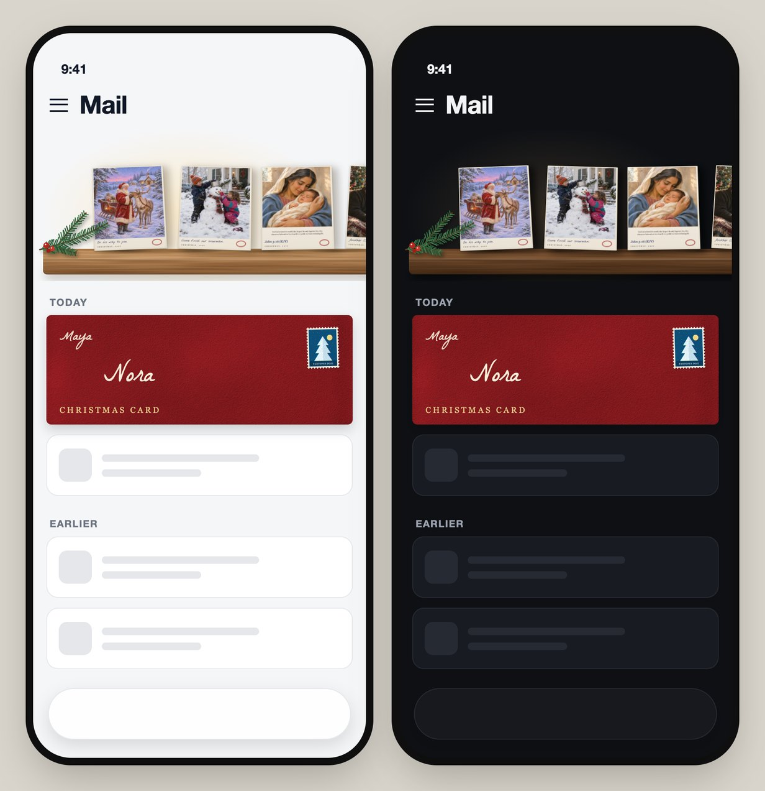
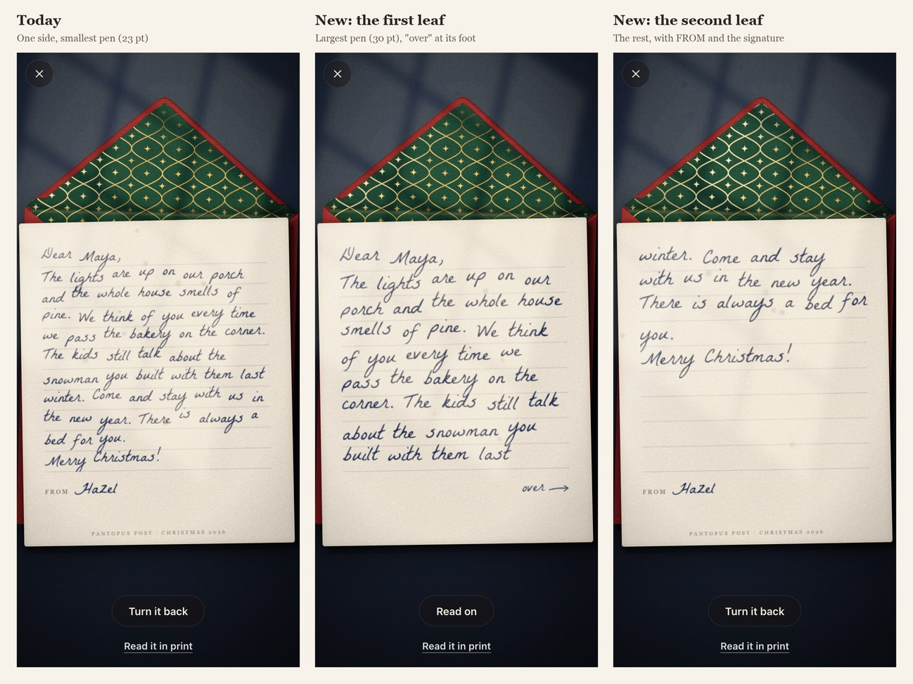

# Christmas cards: easier to read, easier to answer, easier to send

November 17, 2026. A plan and a design. No app code has been changed. It follows the [design plan of November 9](../mail-cards-design-plan-2026-11-09.md), which is fully built, and the founder's request of November 16 for a bigger card, which is on staging.

The founder asked on November 17 what else could be better in sending, drafting, receiving and opening a card, whether the cards are still too small to read for many people, and then said: "Plan everything." Later that morning the founder answered the plan's decisions; they are recorded under [Decided by the founder](#decided-by-the-founder) and the parts below already follow them. Parts 1 to 8 were built that day. Parts 9 and 10 were added that evening, after the founder asked about long notes and about "Help me write it".

## What the review found

Checked by running the real card table from staging code (`dev` at `203707f4bf`) in a browser at 402×874 and 375×667, and by reading the iPhone and Android layout code. The simulators were not run.

**The card is as large as a phone allows.** It is 384 of 402 points wide on an iPhone 17 and 357 of 375 on a small phone. Nothing more can come from the card's size.

**The writing is the problem, for people who need larger text.**

| What | Today |
|---|---|
| The pen | 23 pt on an iPhone 17, small letters about 10 pt tall. That is slightly taller than the phone's normal text, so most people can read it. |
| A short note | The pen never grows. The code only makes it smaller for a long note. A 75-letter note uses 4 of the card's 11 lines and leaves the rest empty. |
| The phone's text size | The card ignores it. About one phone user in five sets larger text. |
| Enlarging | Double-tap enlarges the card 2.4 times, and every line then runs off both sides. Reading means dragging sideways for each line. |
| Small words | The hint under the table's button is 12.5 pt at 70% white. |

**Answering a card.** A reply joined to the card was approved on November 2 and never built. The stamp screens already say "Receiving and replies are free." A sender never learns that a card was loved.

**Sending.** One card takes five pages and then three presses to seal. "Send another card" clears the person, the picture and the note. On Look it over, a panel with the take-back line, the postage line and the main button floats over the bottom of the page on iPhone and Android, more than 200 pt tall, covering the card the page is there to show (the founder's screenshot, November 17). On the web that button sits at the end of a long page.

**After opening.** With several cards waiting, each one means going back to the list. An opened card becomes a row in a list.

**What is strong and stays as it is:** the envelope, the wax seal, the lining, the moods, and both hand-made moments: opening the envelope by hand (turn it over, lift the flap, pull the card out) and sealing it by hand (push the card in, close the flap, press and hold the seal). They are what make it feel like real mail. Nothing in this plan removes a gesture or a step from either moment.

## Rules this plan keeps

1. Paper first. Anything added is an object on the table or a slip of paper, not a form.
2. The card's look does not change. Bigger writing comes from the pen, not from new type on the card.
3. Reuse what is built: the card back's drawing, the verse bookmark, the print's place under the card, the sealing table.
4. No new table and no migration. One new server switch, for replies.
5. Every part is checked in the real apps on web, iPhone (with the iPhone Duo) and Android, from both people's side, after a relaunch.

---

## Part 1. The pen fits the note

**What changes:** the pen is as large as the note allows, in three sizes. A person with little to say writes bigger.

| Lines on the card | Line height | Pen | On an iPhone 17 | Holds about |
|---|---|---|---|---|
| 9 | 9.29u | 7.8u | 30 pt | 200 letters |
| 10 | 8.36u | 7.0u | 27 pt | 240 letters |
| 11 (today) | 7.6u | 6.0u | 23 pt | 300 letters |

`u` is 1% of the card's width, as in [the card's design](../christmas-card-table/design.md).

- **The rule:** use the largest of the three at which the note fits its lines. The ruled lines are drawn at that size's line height. They still start 9u from the top and still fill 83.6u, so the FROM line and the foot do not move.
- **Longer than 11 lines:** today's shrinking stays exactly as it is.
- **The letter counts** were measured with the pen's own font, for a note with a greeting line and a closing line. They are a guide: the size is chosen by measuring the real words, not by counting letters. So most notes, anything up to about 200 letters, get the 30 pt pen.
- **The writer sees it.** On "Write on the back" the writing box uses the same rule as they type: the pen starts large and steps down when the next line would not fit. The count stays "n of 300 letters".
- **Everywhere the back is drawn:** the reader's table, the sealing table, "Open it the way they will", Look it over, Sent, the iPhone Duo's note page, the share pictures with the note on, and the admin's view of a reported card. One shared function in each app decides the size.
- **Nothing is stored.** The reader's app picks the size. A reader on an older app sees today's size. At the edge between two sizes, two apps may differ by one size; that is acceptable.
- **Ink a little stronger.** Each word's ink goes from 86–100% to 93–100%.

Files. Web: `CardPaper.tsx` (`measureNote`, `NOTE_FIT`), `CardPaper.module.css` (`.rules`), `CardBack.tsx` (`BACK_TEXT`, `RULED`), the writing box in `SendCardFlow.tsx`, `sharePicture.ts`. iPhone: `Table/CardTableNoteLayout.swift`, `Table/CardTableFaces.swift`, `HolidayCardNote.swift`, `HolidayCardArt.swift`. Android: `table/CardFacePainter.kt` (`RULES`, `PITCH`, the fitting loop), the writing step in `SendCardSteps.kt`.

Done when: notes of about 40, 150, 225 and 300 letters show at 30, 30, 27 and 23 pt on an iPhone 17 and at the same share of the card on each app (or one size apart at an edge); the lines match the pen; typing past a size's room steps the pen down and deleting steps it up; a note with ten short lines still fits; the share picture, Sent and the Duo's note page show the same size as the table.

---

## Part 2. Read it in print

**What changes:** with the note side up, a reader can open the note in plain type that follows their phone's text size.

- **Where:** on the table, note side up, the card not sealed and not enlarged. The line under the main button reads **Read it in print**. It takes the place of the "double-tap the card to enlarge it" hint on that side. Picture side up, today's hints and "Read the verse" stay.
- **What opens:** the cream bookmark with the red ribbon that "Read the verse" already uses, sliding up over the table.
  - First line, small capitals: FROM {FIRST NAME} · {the day it was mailed}.
  - The note in the card's serif, 19 pt at the normal text size, growing with the phone's setting up to the largest accessibility sizes. Line breaks are kept. It scrolls inside the bookmark when long.
  - Close, tap outside, Back and Escape close it.
- **Larger text set on the phone** (iPhone: above the default size; Android: font scale 1.15 or more): "Read it in print" is drawn as a full button beside "Turn it back", not a small line.
- **Screen readers** read the bookmark as ordinary text.
- **Also** on a reply (Part 3), and from Sent and Look it over, because they use the same table.
- **Not on** a sealed card, and never in a share picture, an email or a public page.

Files. Web: `CardTable.tsx` (the hint and the verse bookmark, about lines 403–447 and 678–713), `CardTable.module.css` (`.bookmark*`, `.verseLink`). iPhone: `Table/CardTableVerseBookmark.swift`, `Table/CardTableControls.swift`, `Table/CardTableModel+Words.swift`. Android: `table/CardTableVerse.kt`, `table/CardTableControls.kt`.

Done when: the bookmark shows the whole note on each app; at the largest text size the words wrap and scroll and nothing is cut; the button form shows only with larger text; a verse card still offers its verse on the picture side; VoiceOver and TalkBack reach the note and Close.

---

## Part 3. Write back

**What changes:** the reply approved on November 2 gets built. It is steps 5 and 6 of the [card memories plan](../christmas-card-memories-plan-2026-11-02.md) with its [contract](../christmas-card-memories-contract-2026-11-02.md) (the three reply routes and the joined-card read). Those documents decide the rules. This part adds how it looks on the table, which was designed after them.

Rules already decided on November 2, unchanged:

- One reply per card, from the person the card went to, to the person who sent it. Only those two can see it.
- Free. It uses no stamp and not the day's card, and it works after December 31.
- It goes with the other person's next 7 a.m. mail and can be taken back until pickup.
- No "opened" notice, no "waiting for a reply" mark, no reminders.
- Report and Block on every reply. A block withdraws a pending reply.
- No new column or table. The reply is one more piece of Mail.

Settled here:

- **Note only in this build.** Up to 300 letters and the saved signature. A photo or voice on a reply waits (D2).
- **The button reads "Write back to {first name}"** (D3). Once the card has been turned over it is in the one row of quiet buttons under the card, after "Open the next card" when cards wait (Part 4), with "Send {first name} a card" beside it while the row has room. The row, from the design check of November 17: under the line slot ("Read the verse", "Read it in print", the hint), at most two quiet buttons side by side, never a second row and never a column; in this order, Open the next card, Write back to {first name} (or You wrote back), Send {first name} a card. If the two don't fit side by side with their full words they use short words, still side by side: "Next card ({n} more)", "Write back", "You wrote back", "Send a card"; where even those don't fit, the row shows the first alone. Screen readers always hear the full words. The rest stay in the ⋯ menu, which starts with "Open the next card ({n} more)" and "Write back to {first name}" or "You wrote back" whenever they apply. "Share this card" keeps its round button in the corner and its line in the ⋯ menu; it is never in the row on a reader's card.
- **Writing it:** a cream sheet the size of the card's back comes up on the card's own cloth. It is the same drawing as the back (ruled lines, the pen at Part 1's sizes, FROM and the signature), with "Dear {first name}," as the faint first line. Under it: "Only you and {first name} can see this." and the letter count. The main button is **Send with the morning mail**.
- **Sending it:** no envelope. The sheet slides up off the table with the paper sound. Then "On its way to {first name}.", "{Name} gets it with their 7 a.m. mail on {day}.", and Take it back.
- **After that:** the quiet button reads "You wrote back" and opens the joined card. The row leaves out the day, which the joined card shows; a screen reader hears it.
- **How it arrives:** in the Mailbox, the row is the opened-card row (the card leaning out of its red envelope) with a cream slip across it that says "{First name} wrote back" in the pen.
- **Opening it:** the table shows the card they sent, picture side up, and the reply sheet lands on it with the set-down sound and one tap you can feel. The whole card stays in view, as the founder asked on November 17: the sheet is 90% of the card's width, turned 2°, with its top at 86% of the card's height, so it lies over the printed strip only, and the card and sheet are sized to fit the table together. Where the joined card can be turned over (the web), with its note side up the sheet lies lower, its top at 92% of the card's height, so the card's FROM line and a drawn signature are clear (design check of November 17); the card is sized for that lower place, so the pair fits between the top buttons and the foot on both sides. On the iPhone and Android the joined card always lies picture side up. Tapping the card brings it to the front; tapping the sheet brings it back. Both people see this joined pair from Incoming, the Vault and Sent.
- **A switch for the founder.** The reply routes need `mailbox` and `holiday_card_memories`, as the contract says, and one new server-only switch, `card_replies`, off by default and on in staging (D4). Apps learn from the joined-card read whether to offer the button.
- **Older app versions.** Store builds carry cards but not replies. Check on a current store build how a reply shows there (expected: a plain letter with its note). If it shows wrongly, record how and keep `card_replies` off in production until the founder decides.

Files. Server: `backend/routes/mailbox.js` (the card routes), `backend/services/holidayCards.js`, `backend/services/cardReports.js` (already expects a reply). Web: `CardTable.tsx`, `CardTablePiece.tsx`, `CardPaper.tsx`, the Mailbox row, `sent/SentPieceView.tsx`. iPhone: `Table/CardTableControls.swift`, `Table/CardTableModel+Actions.swift`, `Table/CardTableHost.swift`, `HolidayCardListViews.swift`, `HolidayCardEnvelope.swift`. Android: `table/CardTableControls.kt`, `table/CardTable.kt`, `HolidayCardRow.kt`, `mail_detail/letter/HolidayCardTablePage.kt`.

Done when: the November 2 plan's checks for steps 5 and 6 pass; a reply written on each app is read on another; a second reply is refused; take-back before pickup works; a block withdraws a pending reply; the joined pair opens from Incoming, the Vault and Sent on both sides; with `card_replies` off no button shows and the routes refuse; the older-app check is written down; at 375×667 on the web, an iPhone SE-size screen and a small Android screen, a turned-over card with a reply and two cards waiting is at least 300 wide (at 402×874 still 384), and nothing under it stacks at the largest text size.

---

## Part 4. The next card

**What changes:** with more cards waiting, the reader goes from one to the next without returning to the list.

- Once the card has been turned over, and other cards can be opened now (delivered, not yet opened, not sealed or the seal has lifted), a quiet button shows, first in the one row under the card (Part 3): **Open the next card ({n} more)**, or "Next card ({n} more)" where two buttons with their full words don't fit side by side. No line under it. Screen readers hear "Open the next card, {n} more waiting". It is also the first line of the ⋯ menu.
- It closes this card and brings the next envelope onto the table, oldest first. That card's first opening plays as usual.
- ✕ still returns to the Mailbox.
- The screen that opens the table passes it the waiting cards from the Mailbox list it already holds. Opened from a notice or a link, with no list in hand, the button does not show.
- On Christmas morning the sealed cards whose seals have lifted count as waiting. That morning is where this matters most.

Files. Web: `CardTablePiece.tsx`, `CardTable.tsx`. iPhone: `Table/CardTableHost.swift`, `Table/CardTableControls.swift`. Android: `mail_detail/letter/HolidayCardTablePage.kt`, `table/CardTableControls.kt`. No server change.

Done when: with three cards waiting, all three open in a row on each app and each is marked opened; a sealed card is skipped until its morning; with one card the button does not show.

---

## Part 5. Shorter sending

Decided by the founder on November 17. Look it over stays for those who want it, and nobody has to pass through it.

**5.1 "Seal it for the day" gets two buttons.**

- **The main button** carries the words Look it over's main button has today: "Seal and send", "Seal it and get the link" for a card by link, "Seal and send {n} cards" for a list. It goes straight to the sealing table, where the card is sealed by hand exactly as today.
- **Under it, "Look it over" as a quiet button**, words only, not a second filled bar. It opens Look it over as it is today.
- **Both are pinned at the bottom of the page** (design check of November 17), on the same soft fade as Look it over's button (5.2), with no solid panel, so both show the moment the step opens at the smallest phone size and the largest text size. The take-back and postage lines stay in the page and scroll; the page leaves room at its end for the last line to scroll clear of the buttons. Where a quiet button sits under the pinned main button, the cloth behind the quiet button is solid: the fade runs from clear at the pinned area's top edge to the cloth's full colour at the main button's vertical middle, and from there down to the bottom of the screen it is the full colour, so no word of the page reads behind or under "Look it over" (re-check of November 17). On a page that isn't the cloth, the same with that page's colour. Look it over's own page, with its one filled button and nothing under it, keeps its fade. Still no boxes or lines in the pinned area.
- **The postage line** shows on this page above the two buttons. The take-back line is already there. So a sender who skips Look it over has still read both. With no stamp left the main button reads "Get stamps to send" and opens the stamp books, as Look it over's does today.
- **The same check still runs.** Pressing the main button runs the server's preview, the check Look it over runs today, before the table shows. A refusal shows as one line directly above the pinned buttons, on its own cream slip in dark red, so it reads over whatever lies behind it.
- **A list:** if the check says any card on the list won't be sent, Look it over opens in place of the table, because that page shows each person's line.
- The step dots stay at five. Look it over is still the fifth page for those who open it.

**5.2 Look it over keeps only its button at the bottom.**

- Today, on iPhone and Android, a solid panel pinned to the bottom holds the take-back line, the postage line and the main button. It covers the lower part of the card on the one page meant for looking at it.
- New, on all three apps: only the main button stays pinned, on a soft fade with no solid panel behind it, about 52 pt tall with 12 pt above it and the safe area below.
- The take-back line and the postage line move to the end of the page and scroll with it. They are also on "Seal it for the day" (5.1), so nothing is lost.
- A refusal, when there is one, shows as one line directly above the button, on its own cream slip in dark red.
- The same for a list's Look it over.
- On the web this also fixes the main button sitting at the end of a long page: it is pinned as "Who it's for" and "Pick a card" are today.

Files. Web: `SendCardFlow.tsx` (`SealStep`, which already sends from itself when the look can't be shown; `LookStep`; `ListLookStep`). iPhone: `HolidayCardLookStep.swift` (`HolidayCardLookFooter`), `HolidayCardFlowView.swift` (what is pinned under each step), `HolidayCardFlowViewModel.swift`, the step-four view in `HolidayCardSteps.swift`. Android: `SendCardLook.kt` (`LookFooter`, `ListLookFooter`), `SendCardScreen.kt`, `SendCardSteps.kt`, `SendCardViewModel.kt`. No server change.

Done when, on each app: both buttons on "Seal it for the day" show the moment it opens, at the smallest phone size and the largest text size, no word of the page can be read behind or under "Look it over", and all three arrival choices and both lines can be scrolled into view; "Seal and send" on "Seal it for the day" reaches the sealing table and the card arrives; "Look it over" opens the page and its one pinned button seals the same way; the card on Look it over is visible down to the button with nothing else over it; the take-back and postage lines read at the end of that page and on "Seal it for the day"; out of stamps opens the stamp books from both pages; a refusal shows before the table; a list with one card that won't go opens Look it over; by link and by email work the same way; a relaunch on either page keeps the draft.

---

## Part 6. Send this card to someone else

**What changes:** the fastest second card.

- After a card is sent, and on its page in Sent, beside "Send another card": **Send this card to someone else**.
- It opens "Who it's for" with the same picture and the saved signature already chosen. The note starts empty. The arrival choice is asked again.
- It shows only when another card can be sent now (a stamp left, or today's card not used).

Files. Web: `SendCardFlow.tsx` (`startOver` and the sent step), `sent/SentPieceView.tsx`. iPhone: `HolidayCardSealViews.swift`, `HolidayCardFlowViewModel.swift`. Android: `SendCardSeal.kt`, `table/CardSenderActions.kt`, `SendCardViewModel.kt`. No server change.

Done when: the second card goes out with the same picture in three pages on each app; with no stamp left the button does not show.

---

## Part 7. The mantel

**What changes:** this season's opened cards stand on a shelf at the top of the Mailbox, as cards stand on a mantel at home. The founder approved the look on November 17 from this sample:

The sample's source is [mantel/mantel.html](mantel/mantel.html); open it from the repository. It is the source of truth for anything not spelled out here. The grey rows and the tab bar in it are stand-ins: the real Mailbox list and tab bar stay as they are.

**Where and when**

- The first thing in the Mailbox's personal list, on web, iPhone and Android, when that list holds at least one opened Christmas card from this season. It scrolls away with the list; it is not pinned.
- On the shelf: opened Christmas cards the person received. Not on it: unopened cards, sealed cards, replies, and cards the person sent.
- Opened cards also keep their rows in the list, so nothing moves out of it.
- From the first opened card through January 6 by the person's own clock. After that the shelf goes and the cards stay where they are today.
- No server change: the personal list already carries each opened card's picture. The shelf shows the opened cards the list has loaded, newest opened at the left, 30 at most.

**The drawing** (points; the strip is as wide as the list)

| Piece | How |
|---|---|
| The strip | 182 tall, the page's own colour behind it. No box and no edge. |
| The light | A warm pool behind the cards: a radial fade centred 46% across and 62% down, 62% of the strip wide and 70% tall, to nothing at 72%. Light mode `rgba(255, 226, 170, 0.55)`, dark mode `rgba(255, 196, 120, 0.16)`. |
| The shelf | Art, `mantel-shelf-light.webp` and `mantel-shelf-dark.webp` (1200 × 50 at 3×, its shadow included). Its left end is 12 from the strip's left edge, its top 143 from the strip's top. It runs off the right edge. It does not move when the cards scroll. |
| A card | The app's own small card face with its caption strip, 88 wide and 105.6 tall. Its lower edge is 38 above the strip's bottom, on the shelf's top surface. |
| Its lean | Tipped back 11° about its lower edge, with a perspective of 520. Turned between −2.4° and +2.4°, taken from the card's number with the same seeded numbers the note's words use: the second draw from the seed number × 7 + 3, as (draw − 0.5) × 4.8°, so a card stands the same way every time and on all three apps. |
| Its shadows | On the wall: 7 right, 2 down, 5 soft, `rgba(60, 40, 10, 0.26)` in light mode and `rgba(0, 0, 0, 0.6)` in dark. On the shelf: an ellipse 88 × 7 under the card, 38% black at its middle fading to nothing. |
| The row | The first card's left edge is 74 from the strip's left edge, 13 between cards, 16 after the last. About three and a half show on a phone; the row scrolls sideways under the finger. |
| The fir sprig | Art, `mantel-sprig.webp` (104 × 68 at 3×, its shadow included), at the strip's left edge, its top 90 from the strip's top. It lies on the shelf's top surface, drawn in front of the cards, and scrolls with them. |

**Using it**

- Tapping a card opens it on its table, already out of its envelope, as its row does.
- Screen readers: the shelf is a list named "Your Christmas cards, {n}". Each card reads "Card from {first name}: {caption}".
- Nothing on it moves by itself, so Reduce Motion changes nothing.
- The iPhone Duo, open or closed, and the web at desktop width show the same strip across the list's column.

**The art** is in [mantel/art](mantel/art), rendered from the approved sample. Each app ships its own copy: the web under `frontend/apps/web/public/holiday-cards/table/`, the iPhone as loose WebP resources beside the table's art, Android in `res/drawable-nodpi`. Do not redraw the wood or the sprig in code.

Files. Web: the personal list's page under `app/(site)/(app)/app/mailbox/`, `MailRow`, the card face in `mailbox/cards/CardPaper.tsx`. iPhone: the Mailbox list screen, `HolidayCardListViews.swift`, `HolidayCardView.swift`. Android: the Mailbox list screen, `HolidayCardRow.kt`, `table/CardFacePainter.kt`. Confirm each before editing.

Done when, on each app: with no opened card there is no strip; with one, it stands on the shelf; with five, the row scrolls and the shelf stays still; light and dark match the sample; a tap opens that card on its table; an unopened, a sealed and a sent card are not on the shelf; the strip scrolls away with the list; a relaunch shows the same cards at the same angles; with the phone's clock on January 7 the strip is gone and the rows remain.

---

## Part 8. Small fixes

| # | Change | Where |
|---|---|---|
| 8.1 | The page a card's link opens, and Look it over's copy of it, say "Verified resident" under the sender's name, not "Verified neighbor" (D1). "Verified business" stays. | Web `OpenLetterView.tsx` (two places). iPhone `HolidayCardLookPictures.swift`, `Table/CardTableLinkViews.swift`. Android `SendCardLook.kt`. |
| 8.2 | The hint under the table's button goes from 12.5 pt at 70% white to 15 pt at 85%. | Web `CardTable.module.css` (`.hint`). The table controls on iPhone and Android. |
| 8.3 | Web: the table cannot scroll inside itself. Today it holds about 55 px of hidden room, and anything that scrolls a button into view pushes the ✕ off the top with no way back. | `CardTable.module.css` (the stage). |
| 8.4 | iPhone: look at "Write on the back" on a current build. A November 16 screenshot shows a dark strip down the right edge, as if the cloth stopped about 40 pt short. Fix it if it shows. | `HolidayCardTableCloth.swift`, `HolidayCardFlowView.swift`. |

---

## Part 9. A long note runs onto a second leaf

Added on the evening of November 17. The founder asked how a long note could keep showing everything with the best experience, without shortening what "Help me write it" writes.

**What changes:** a long note gets more paper, not smaller writing. The smallest pen is no longer used on one side. A note that would need it is written in the largest pen over two leaves.

The picture is the real card and pen on the web at 402×874. The same note takes 14 lines in the largest pen: nine on the first leaf and five on the second.

| The note, laid out as Part 1 does | Before this part | With this part |
|---|---|---|
| Fits 9 lines in the 7.8u pen (about 200 letters) | One side, 30 pt on an iPhone 17 | The same |
| Fits 10 lines in the 7.0u pen (about 240 letters) | One side, 27 pt | The same |
| Longer than that, up to the 300 letters a card holds | One side, 23 pt | Two leaves, 30 pt |

**The rule.** One function in each app, the one Part 1 added:

1. If the note fits 9 lines at 7.8u, or 10 lines at 7.0u, it is on one side, exactly as before.
2. Otherwise it is on two leaves, at the first of these that holds it: 7.8u with 9 lines a leaf (18 lines), 7.0u with 10 lines a leaf (20), 6.0u with 11 lines a leaf (22).
3. Otherwise (a note of very many short lines) it is on one side with the shrinking Part 1 kept, unchanged.

**The break.** The first leaf takes the first 9 lines as the pen wraps them (10 or 11 in the smaller pens), and the second leaf takes the rest, never fewer than two lines. A blank line that would be the second leaf's first line is left out. Each word keeps the shift, the turn and the ink it would have had on one side: they are drawn for the whole note in order, then the lines are dealt to the leaves.

**The two leaves.**

- **The first leaf** lies on the card's back: the same paper, the same size, the same ruled lines for its pen, starting 9u from the top. It has no FROM, no signature and no foot line. At its foot, in the pen, is the word "over" with a short arrow: the word 5.6u high in the pen's ink at 82%, turned 2° up to the right, its right end 8u from the leaf's right edge and its top 97.5u down. The arrow is 8u wide and 3.2u high, a 1.7-wide round stroke in a 40 by 16 box: `M2 9.5C10 7.2 22 7 36 8` and `M29.5 3.2 36.6 8 29 13`.
- **The second leaf is the card's own back**, as it is drawn now: the rest of the note from the first rule, then FROM, the signature and the foot line. The signature comes at the end, as in a letter.

**On the table.**

- "Turn it over" brings the note side up on the first leaf. The main button reads **Read on**. A tap on the card does the same. A swipe still turns the card back to its picture.
- **Read on:** the first leaf lifts from its foot, hinged along its top edge, and is gone. It turns about the top edge from 0° to 90° in 0.45 s, easing in, with the same depth the card's own turn uses. It darkens by up to 22% as it rises and is not drawn past 90°. With reduced motion it fades out in 0.2 s. It makes the paper sound the card's turn makes, when sounds are on.
- With the second leaf up the main button reads **Turn it back**, and a tap or a swipe turns the card, as before.
- Turned back to its picture, the card has its first leaf in place again. Turning it over always starts at the first leaf.
- The line under the button stays **Read it in print** on both leaves. It prints the whole note.
- Enlarging works on either leaf as it does now.
- Screen readers hear the whole note once, note side up, as now. The main button is spoken "Read on, the note continues on a second leaf".

**Where.** Wherever the card lies on a table and can be turned: the reader's table, the page a card's link opens, Sent, Look it over, "Open it the way they will", the card inside the web's joined pair, and the iPhone Duo's note page. Any still drawing of the back (a share picture with the note on, the admin's view of a reported card) keeps Part 1's one-side fitting, smallest pen and shrinking included. The reply's own sheet keeps Part 1's rule in this part.

**The writer.** The writing box stays as it is. When the note will take two leaves, a quiet line under the box reads "This note runs onto a second leaf." It goes away when the note fits one side again. The count stays "n of 300 letters". Look it over shows the two leaves as the reader will see them.

**Nothing is stored and the server does not change.** The reader's app deals the leaves. A reader on an older app sees one side in the small pen, as before. Two apps may break a line a word apart; no word may be lost or shown twice.

Files. Web: `CardPaper.tsx` (`measureNote`, `PaperBack`), `CardTable.tsx`, `cardTableEngine.ts` (the tap and the main button's step), `CardTable.module.css`, the writing step in `SendCardFlow.tsx`. iPhone: `Table/CardTableNoteLayout.swift`, `Table/CardTableFaces.swift`, `Table/CardTableControls.swift`, `Table/CardTableModel+Words.swift`. Android: `table/CardFacePainter.kt`, `table/CardTableControls.kt`, the writing step in `SendCardSteps.kt`.

Done when, on each app, with the sample's 296-letter note:

- Note side up, the first leaf shows nine lines in the largest pen with "over" at its foot, and the button reads "Read on".
- The button, and a tap on the card, lift the leaf. The card's back then shows the remaining lines, FROM and the signature, and the button reads "Turn it back".
- The last word of the first leaf and the first word of the second are neighbours in the note. No word is missing or repeated.
- Turning back and over again starts at the first leaf.
- A note of about 230 letters is on one side in the middle pen, and one of about 150 letters on one side in the largest pen, both as before.
- "Read it in print" shows the whole note from either leaf. VoiceOver and TalkBack read the whole note and the button's words.
- With reduced motion the leaf fades.
- The writing step shows its line when the note passes one side and drops it when the note is cut back. Look it over shows both leaves.
- A card written on one app reads on two leaves on the other two.

---

## Part 10. "Help me write it" names one person only

Added on the evening of November 17. The help writes three notes for the card's back (launch key `card_note_help`, on in production since November 14). Until now it greeted two chosen people by name on both cards ("Dear Maria and Tom,") and named no one from three people up.

**What changes:** a first name goes into the greeting only when the card goes to exactly one person. For two or more it names no one ("Dear friends," or straight into the note).

- **Why:** each person on a list gets their own card, and the list page says "No one sees who else got one." Both names on both cards tell each of them that the other got one. The app cannot know that two people are a couple; a sender who wants both names can type them.
- **Server:** `backend/services/ai/cardNote.js` (`toLine`) and the greeting rule in `cardNoteSystem` (`backend/services/ai/prompts.js`), with the prompt's version raised. The length it aims for, the three tones and every other rule stay as they are.
- **The help panel's first line, on each app:** two people read "One note for both of them, so it names no one." Three or more stay "One note for all 5 people, so it names no one." One named person stays "For Maria."
- **The writing box's grey example line** reads "Dear friends," on a card to two or more people.
- An older app keeps its old first line over notes that now name no one. Accepted.

Done when: with two people chosen, the three notes name no one on each app; with one person they still open "Dear {first name},".

---

## Left out, and why

- **The phone reading the note aloud.** A machine voice on a personal card works against the feeling. The sender's own voice greeting is the human way.
- **Turning the phone sideways.** A card that fits a sideways phone is smaller than the upright one.
- **A saved Christmas list** (the people you send to each year, ticked off as cards go). Worth doing next year, once there is a first year to remember.
- Links, documents, video and music in a card: decided on November 9.

## Order of work

| Wave | Parts | Needs |
|---|---|---|
| A | Part 1, Part 2, Part 8, Part 5, Part 4, Part 6, in that order | Apps and web only. The wave to get into the next store builds. |
| B | Part 3 | Server first, then the three apps. One new server switch. The server work starts alongside wave A. |
| C | Part 7 | The founder approved its sample on November 17. New art, already made. |
| D | Part 10, then Part 9 | Added on the evening of November 17. Part 10 is the server and one line on each app. Part 9 is the apps and web only. |

Each line is a small set of pull requests into `dev`: web (with the server where there is one), iPhone with the Duo, Android.

## Decided by the founder

November 17, 2026. The plan offered seven decisions with defaults. The founder's answer, in the founder's words:

- On the hand gestures: "we can still have users seal the envelope gestures, right? even if we can do less steps if we need to. And we can still also have users open the envelope gestures, even if less steps. Those are simulating receiving a real envelope." Yes: both moments stay as they are.
- On D5: "For D5, no, I agree partially, however, we should have an option to go straight to the sealing table but some users may still want to look over. So, let's just have the Seal and send button on top of "Look it over" button, then if users choose look it over button then they get to go to the same screen, which has the "Seal and send" button only again."
- On Look it over's bottom panel: "at the current "Seal and send" screen, this part is always floating on top of the screen to block a big part view of the screen, which is what "Look it over" for, users want to view the mail card that they are about to send, now we block part of the screen using this, which is not a very nice experience. We can still use this but maybe change to a different way of doing it."
- On who builds: "when building this, let's use Opus 5.5 model at Extra High instead of Fable 5.2."
- On everything else: "These are all the things to change or add, otherwise please use your proposed points on all other things."
- On the mantel's sample picture, asked "Do you approve the mantel's look in the sample picture?": "Yes, build it"

So:

| # | Decision | Decided |
|---|---|---|
| D1 | The words under a verified sender on a card's link page | "Verified resident" |
| D2 | A reply carries a note only in this build; a photo or voice on a reply comes later | Yes |
| D3 | The reply button reads "Write back to {first name}", not November 2's "Add your memory" | Yes |
| D4 | Replies get their own server switch, `card_replies`, on in staging and off in production until the founder sets it | Yes |
| D5 | Was: a card to one person skips Look it over. | **No.** Replaced by Part 5: "Seal and send" above "Look it over" on "Seal it for the day", and Look it over keeps only its button at the bottom. How the panel changes (5.2) is the design session's reading of "a different way of doing it". |
| D6 | The mantel is built only after the founder approves one sample picture, which the design session makes | Yes. The sample was approved the same day (Part 7). |
| D7 | The three pen sizes as in the picture above (30, 27 and 23 pt on an iPhone 17) and the slightly stronger ink | Yes |

**The evening of November 17.** After Parts 1 to 8 were built, the founder asked about "Help me write it" and about long notes. In the founder's words:

- On shortening what the help writes so it fits the largest pen: "No I think we do not need to short, we need to figure out when the notes are long how we adjust so we can continue to show everything with the best experience." Part 9 is the answer: a second leaf.
- On whom the help greets: "Yes, please change the 2 people to dear friends too, so 2 or more will be dear friends coming back from AI help notes." Part 10.
- On who builds and who reviews: "I will want you to start a Opus 5.5 Extra High session to do the actual coding work and verify in emulator and simulator and web apps, and create PR and you review." And: "Either way, please start the work, you have my full permission to start the work now."

The founder left it to the design session whether to draw Part 9 first. It drew the sample in Part 9 from the real card and wrote the part before the build sessions started on it. The sample was sent to the founder, not held for an approval.

## How the build runs

**For Parts 9 and 10 (wave D)** the same three sessions build, with one change from the list below: a session opens its pull request, checks it in the real app, and does not merge. The design session reads the diff, looks at the web itself, and writes "reviewed, merge" in the notes file; the session merges after that.

- Three build sessions on Opus 5.5 at Extra High, each in its own worktree and branch from `origin/dev`: server and web (label CARDUX-WEB), iPhone with the Duo (CARDUX-IOS), Android (CARDUX-AND). Each owns its own area and asks the owning session for a change in another.
- The design session that wrote this plan writes no app code and reviews none. It answers design questions left in the notes file. It drew the mantel's sample and its art.
- One shared notes file, `~/pantopus-plans/card-ux-notes/NOTES.md`: the rig's addresses, choices a session made, the reply's answer shapes, and one status line per pull request. Every session reads it before each part and appends to it.
- Every pull request goes into `dev` (`--base dev`), never master. Each session merges its own after green CI and a real-app check. Only the founder promotes staging to production.
- A session never ends a turn with a question to the founder. It picks the choice, writes it in the shared notes file, and carries on. It keeps working through the condensing of its context and writes must-keep facts to the notes file first.
- No unit tests. Each part is verified in the real apps against a local backend and database with made-up people: web in a browser at phone and desktop sizes and 200% text, iPhone in a simulator, the Duo closed and open, Android in an emulator at font scale 2.0, with a relaunch, and from the other person's side.
- Subagents only as Opus 5.5 at Extra High.
- No migration is expected. If a piece seems to need one, that piece stops with a NEEDS-FOUNDER line and the rest carries on.
- Before taking a port or a rig, check that no other session is using it. Never touch the founder's own environment: the main checkout, the backend on port 8000, the founder's simulator.
- File names above were read on `dev` at `203707f4bf`. Confirm each before editing.
- The card table runs with no backend at `/dev/card-film` on a web dev server with the card switches on (`?scene=open`, `sealed`, `send` or `rack`). It is the quickest place to see Parts 1, 2 and 8.

The founder's own steps: switching `card_replies` on in production, promoting staging to production, and the next iPhone and Android store builds.

## Not verified in this review

- iPhone, Android and the iPhone Duo in simulators, and any real phone. Their sizes were read from code that uses the same numbers as the web.
- "Who it's for" and "Pick a card" on any app.
- How other card apps handle reading and replies: nothing solid and current was found.
