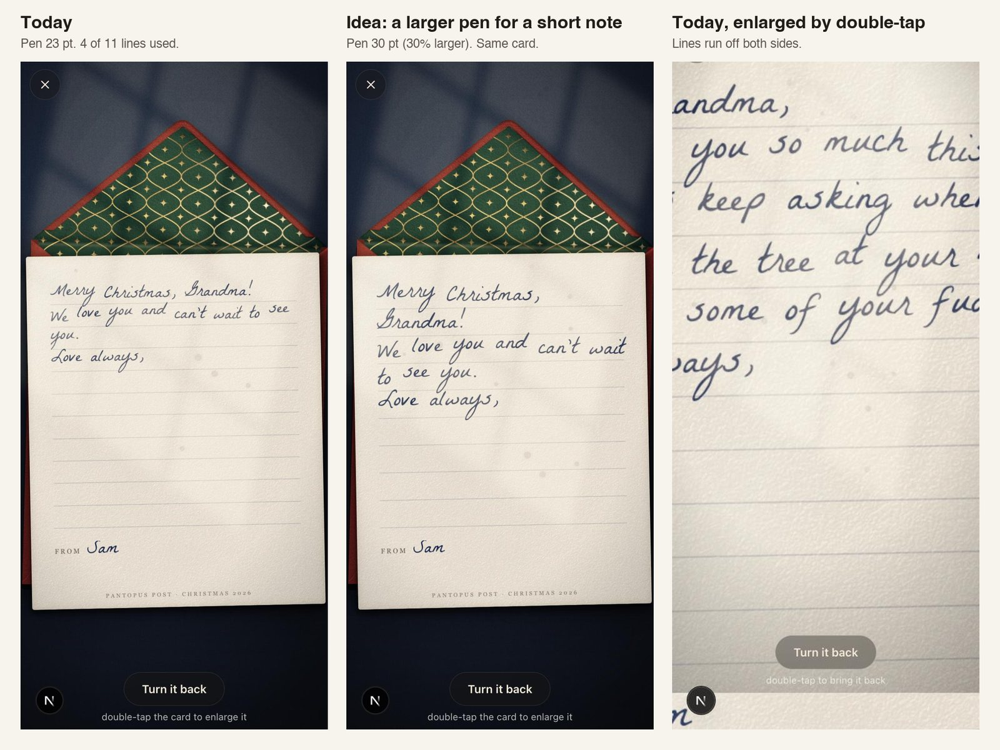

# Christmas cards: easier to read, easier to answer, easier to send

November 17, 2026. A plan and a design. No app code has been changed. It follows the [design plan of November 9](../mail-cards-design-plan-2026-11-09.md), which is fully built, and the founder's request of November 16 for a bigger card, which is on staging.

The founder asked on November 17 what else could be better in sending, drafting, receiving and opening a card, whether the cards are still too small to read for many people, and then said: "Plan everything." Later that morning the founder answered the plan's decisions; they are recorded under [Decided by the founder](#decided-by-the-founder) and the parts below already follow them.

## What the review found

Checked by running the real card table from staging code (`dev` at `203707f4bf`) in a browser at 402×874 and 375×667, and by reading the iPhone and Android layout code. The simulators were not run.

**The card is as large as a phone allows.** It is 384 of 402 points wide on an iPhone 17 and 357 of 375 on a small phone. Nothing more can come from the card's size.

**The writing is the problem, for people who need larger text.**

| What | Today |
|---|---|
| The pen | 23 pt on an iPhone 17, small letters about 10 pt tall. That is slightly taller than the phone's normal text, so most people can read it. |
| A short note | The pen never grows. The code only makes it smaller for a long note. A 75-letter note uses 4 of the card's 11 lines and leaves the rest empty. |
| The phone's text size | The card ignores it. About one phone user in five sets larger text. |
| Enlarging | Double-tap enlarges the card 2.4 times, and every line then runs off both sides. Reading means dragging sideways for each line. |
| Small words | The hint under the table's button is 12.5 pt at 70% white. |

**Answering a card.** A reply joined to the card was approved on November 2 and never built. The stamp screens already say "Receiving and replies are free." A sender never learns that a card was loved.

**Sending.** One card takes five pages and then three presses to seal. "Send another card" clears the person, the picture and the note. On Look it over, a panel with the take-back line, the postage line and the main button floats over the bottom of the page on iPhone and Android, more than 200 pt tall, covering the card the page is there to show (the founder's screenshot, November 17). On the web that button sits at the end of a long page.

**After opening.** With several cards waiting, each one means going back to the list. An opened card becomes a row in a list.

**What is strong and stays as it is:** the envelope, the wax seal, the lining, the moods, and both hand-made moments: opening the envelope by hand (turn it over, lift the flap, pull the card out) and sealing it by hand (push the card in, close the flap, press and hold the seal). They are what make it feel like real mail. Nothing in this plan removes a gesture or a step from either moment.

## Rules this plan keeps

1. Paper first. Anything added is an object on the table or a slip of paper, not a form.
2. The card's look does not change. Bigger writing comes from the pen, not from new type on the card.
3. Reuse what is built: the card back's drawing, the verse bookmark, the print's place under the card, the sealing table.
4. No new table and no migration. One new server switch, for replies.
5. Every part is checked in the real apps on web, iPhone (with the iPhone Duo) and Android, from both people's side, after a relaunch.

---

## Part 1. The pen fits the note

**What changes:** the pen is as large as the note allows, in three sizes. A person with little to say writes bigger.

| Lines on the card | Line height | Pen | On an iPhone 17 | Holds about |
|---|---|---|---|---|
| 9 | 9.29u | 7.8u | 30 pt | 200 letters |
| 10 | 8.36u | 7.0u | 27 pt | 240 letters |
| 11 (today) | 7.6u | 6.0u | 23 pt | 300 letters |

`u` is 1% of the card's width, as in [the card's design](../christmas-card-table/design.md).

- **The rule:** use the largest of the three at which the note fits its lines. The ruled lines are drawn at that size's line height. They still start 9u from the top and still fill 83.6u, so the FROM line and the foot do not move.
- **Longer than 11 lines:** today's shrinking stays exactly as it is.
- **The letter counts** were measured with the pen's own font, for a note with a greeting line and a closing line. They are a guide: the size is chosen by measuring the real words, not by counting letters. So most notes, anything up to about 200 letters, get the 30 pt pen.
- **The writer sees it.** On "Write on the back" the writing box uses the same rule as they type: the pen starts large and steps down when the next line would not fit. The count stays "n of 300 letters".
- **Everywhere the back is drawn:** the reader's table, the sealing table, "Open it the way they will", Look it over, Sent, the iPhone Duo's note page, the share pictures with the note on, and the admin's view of a reported card. One shared function in each app decides the size.
- **Nothing is stored.** The reader's app picks the size. A reader on an older app sees today's size. At the edge between two sizes, two apps may differ by one size; that is acceptable.
- **Ink a little stronger.** Each word's ink goes from 86–100% to 93–100%.

Files. Web: `CardPaper.tsx` (`measureNote`, `NOTE_FIT`), `CardPaper.module.css` (`.rules`), `CardBack.tsx` (`BACK_TEXT`, `RULED`), the writing box in `SendCardFlow.tsx`, `sharePicture.ts`. iPhone: `Table/CardTableNoteLayout.swift`, `Table/CardTableFaces.swift`, `HolidayCardNote.swift`, `HolidayCardArt.swift`. Android: `table/CardFacePainter.kt` (`RULES`, `PITCH`, the fitting loop), the writing step in `SendCardSteps.kt`.

Done when: notes of about 40, 150, 225 and 300 letters show at 30, 30, 27 and 23 pt on an iPhone 17 and at the same share of the card on each app (or one size apart at an edge); the lines match the pen; typing past a size's room steps the pen down and deleting steps it up; a note with ten short lines still fits; the share picture, Sent and the Duo's note page show the same size as the table.

---

## Part 2. Read it in print

**What changes:** with the note side up, a reader can open the note in plain type that follows their phone's text size.

- **Where:** on the table, note side up, the card not sealed and not enlarged. The line under the main button reads **Read it in print**. It takes the place of the "double-tap the card to enlarge it" hint on that side. Picture side up, today's hints and "Read the verse" stay.
- **What opens:** the cream bookmark with the red ribbon that "Read the verse" already uses, sliding up over the table.
  - First line, small capitals: FROM {FIRST NAME} · {the day it was mailed}.
  - The note in the card's serif, 19 pt at the normal text size, growing with the phone's setting up to the largest accessibility sizes. Line breaks are kept. It scrolls inside the bookmark when long.
  - Close, tap outside, Back and Escape close it.
- **Larger text set on the phone** (iPhone: above the default size; Android: font scale 1.15 or more): "Read it in print" is drawn as a full button beside "Turn it back", not a small line.
- **Screen readers** read the bookmark as ordinary text.
- **Also** on a reply (Part 3), and from Sent and Look it over, because they use the same table.
- **Not on** a sealed card, and never in a share picture, an email or a public page.

Files. Web: `CardTable.tsx` (the hint and the verse bookmark, about lines 403–447 and 678–713), `CardTable.module.css` (`.bookmark*`, `.verseLink`). iPhone: `Table/CardTableVerseBookmark.swift`, `Table/CardTableControls.swift`, `Table/CardTableModel+Words.swift`. Android: `table/CardTableVerse.kt`, `table/CardTableControls.kt`.

Done when: the bookmark shows the whole note on each app; at the largest text size the words wrap and scroll and nothing is cut; the button form shows only with larger text; a verse card still offers its verse on the picture side; VoiceOver and TalkBack reach the note and Close.

---

## Part 3. Write back

**What changes:** the reply approved on November 2 gets built. It is steps 5 and 6 of the [card memories plan](../christmas-card-memories-plan-2026-11-02.md) with its [contract](../christmas-card-memories-contract-2026-11-02.md) (the three reply routes and the joined-card read). Those documents decide the rules. This part adds how it looks on the table, which was designed after them.

Rules already decided on November 2, unchanged:

- One reply per card, from the person the card went to, to the person who sent it. Only those two can see it.
- Free. It uses no stamp and not the day's card, and it works after December 31.
- It goes with the other person's next 7 a.m. mail and can be taken back until pickup.
- No "opened" notice, no "waiting for a reply" mark, no reminders.
- Report and Block on every reply. A block withdraws a pending reply.
- No new column or table. The reply is one more piece of Mail.

Settled here:

- **Note only in this build.** Up to 300 letters and the saved signature. A photo or voice on a reply waits (D2).
- **The button reads "Write back to {first name}"** (D3). It is the first quiet button under "Turn it back" once the card has been turned over, with "Send {first name} a card" beside it. "Share this card" keeps its round button in the corner and its line in the ⋯ menu.
- **Writing it:** a cream sheet the size of the card's back comes up on the card's own cloth. It is the same drawing as the back (ruled lines, the pen at Part 1's sizes, FROM and the signature), with "Dear {first name}," as the faint first line. Under it: "Only you and {first name} can see this." and the letter count. The main button is **Send with the morning mail**.
- **Sending it:** no envelope. The sheet slides up off the table with the paper sound. Then "On its way to {first name}.", "{Name} gets it with their 7 a.m. mail on {day}.", and Take it back.
- **After that:** the quiet button reads "You wrote back · {day}" and opens the joined card.
- **How it arrives:** in the Mailbox, the row is the opened-card row (the card leaning out of its red envelope) with a cream slip across it that says "{First name} wrote back" in the pen.
- **Opening it:** the table shows the card they sent, picture side up, and the reply sheet lands on it with the set-down sound and one tap you can feel. The sheet lies over the lower part of the card, turned 2°. Tapping the card brings it to the front; tapping the sheet brings it back. Both people see this joined pair from Incoming, the Vault and Sent.
- **A switch for the founder.** The reply routes need `mailbox` and `holiday_card_memories`, as the contract says, and one new server-only switch, `card_replies`, off by default and on in staging (D4). Apps learn from the joined-card read whether to offer the button.
- **Older app versions.** Store builds carry cards but not replies. Check on a current store build how a reply shows there (expected: a plain letter with its note). If it shows wrongly, record how and keep `card_replies` off in production until the founder decides.

Files. Server: `backend/routes/mailbox.js` (the card routes), `backend/services/holidayCards.js`, `backend/services/cardReports.js` (already expects a reply). Web: `CardTable.tsx`, `CardTablePiece.tsx`, `CardPaper.tsx`, the Mailbox row, `sent/SentPieceView.tsx`. iPhone: `Table/CardTableControls.swift`, `Table/CardTableModel+Actions.swift`, `Table/CardTableHost.swift`, `HolidayCardListViews.swift`, `HolidayCardEnvelope.swift`. Android: `table/CardTableControls.kt`, `table/CardTable.kt`, `HolidayCardRow.kt`, `mail_detail/letter/HolidayCardTablePage.kt`.

Done when: the November 2 plan's checks for steps 5 and 6 pass; a reply written on each app is read on another; a second reply is refused; take-back before pickup works; a block withdraws a pending reply; the joined pair opens from Incoming, the Vault and Sent on both sides; with `card_replies` off no button shows and the routes refuse; the older-app check is written down.

---

## Part 4. The next card

**What changes:** with more cards waiting, the reader goes from one to the next without returning to the list.

- Once the card has been turned over, and other cards can be opened now (delivered, not yet opened, not sealed or the seal has lifted), a quiet button shows: **Open the next card**, with "{n} more waiting" as the line under it.
- It closes this card and brings the next envelope onto the table, oldest first. That card's first opening plays as usual.
- ✕ still returns to the Mailbox.
- The screen that opens the table passes it the waiting cards from the Mailbox list it already holds. Opened from a notice or a link, with no list in hand, the button does not show.
- On Christmas morning the sealed cards whose seals have lifted count as waiting. That morning is where this matters most.

Files. Web: `CardTablePiece.tsx`, `CardTable.tsx`. iPhone: `Table/CardTableHost.swift`, `Table/CardTableControls.swift`. Android: `mail_detail/letter/HolidayCardTablePage.kt`, `table/CardTableControls.kt`. No server change.

Done when: with three cards waiting, all three open in a row on each app and each is marked opened; a sealed card is skipped until its morning; with one card the button does not show.

---

## Part 5. Shorter sending

Decided by the founder on November 17. Look it over stays for those who want it, and nobody has to pass through it.

**5.1 "Seal it for the day" gets two buttons.**

- **The main button** carries the words Look it over's main button has today: "Seal and send", "Seal it and get the link" for a card by link, "Seal and send {n} cards" for a list. It goes straight to the sealing table, where the card is sealed by hand exactly as today.
- **Under it, a second, quieter button: "Look it over".** It opens Look it over as it is today.
- **The postage line** shows on this page above the two buttons. The take-back line is already there. So a sender who skips Look it over has still read both. With no stamp left the main button reads "Get stamps to send" and opens the stamp books, as Look it over's does today.
- **The same check still runs.** Pressing the main button runs the server's preview, the check Look it over runs today, before the table shows. A refusal shows on this page under the choices, where a refusal shows today.
- **A list:** if the check says any card on the list won't be sent, Look it over opens in place of the table, because that page shows each person's line.
- The step dots stay at five. Look it over is still the fifth page for those who open it.

**5.2 Look it over keeps only its button at the bottom.**

- Today, on iPhone and Android, a solid panel pinned to the bottom holds the take-back line, the postage line and the main button. It covers the lower part of the card on the one page meant for looking at it.
- New, on all three apps: only the main button stays pinned, on a soft fade with no solid panel behind it, about 52 pt tall with 12 pt above it and the safe area below.
- The take-back line and the postage line move to the end of the page and scroll with it. They are also on "Seal it for the day" (5.1), so nothing is lost.
- A refusal, when there is one, shows as one line directly above the button.
- The same for a list's Look it over.
- On the web this also fixes the main button sitting at the end of a long page: it is pinned as "Who it's for" and "Pick a card" are today.

Files. Web: `SendCardFlow.tsx` (`SealStep`, which already sends from itself when the look can't be shown; `LookStep`; `ListLookStep`). iPhone: `HolidayCardLookStep.swift` (`HolidayCardLookFooter`), `HolidayCardFlowView.swift` (what is pinned under each step), `HolidayCardFlowViewModel.swift`, the step-four view in `HolidayCardSteps.swift`. Android: `SendCardLook.kt` (`LookFooter`, `ListLookFooter`), `SendCardScreen.kt`, `SendCardSteps.kt`, `SendCardViewModel.kt`. No server change.

Done when, on each app: "Seal and send" on "Seal it for the day" reaches the sealing table and the card arrives; "Look it over" opens the page and its one pinned button seals the same way; the card on Look it over is visible down to the button with nothing else over it; the take-back and postage lines read at the end of that page and on "Seal it for the day"; out of stamps opens the stamp books from both pages; a refusal shows before the table; a list with one card that won't go opens Look it over; by link and by email work the same way; a relaunch on either page keeps the draft.

---

## Part 6. Send this card to someone else

**What changes:** the fastest second card.

- After a card is sent, and on its page in Sent, beside "Send another card": **Send this card to someone else**.
- It opens "Who it's for" with the same picture and the saved signature already chosen. The note starts empty. The arrival choice is asked again.
- It shows only when another card can be sent now (a stamp left, or today's card not used).

Files. Web: `SendCardFlow.tsx` (`startOver` and the sent step), `sent/SentPieceView.tsx`. iPhone: `HolidayCardSealViews.swift`, `HolidayCardFlowViewModel.swift`. Android: `SendCardSeal.kt`, `table/CardSenderActions.kt`, `SendCardViewModel.kt`. No server change.

Done when: the second card goes out with the same picture in three pages on each app; with no stamp left the button does not show.

---

## Part 7. The mantel

**What changes:** this season's opened cards stand on a shelf at the top of the Mailbox, as cards stand on a mantel at home. Design first: nothing is built until the founder approves one sample picture (D6).

- **Where:** the top of the Mailbox's personal list, on web, iPhone and Android, when the person has at least one opened Christmas card this season.
- **What shows:** a wooden shelf about 150 pt tall. The opened cards stand on it, newest at the left, each the real card face about 84 pt wide, leaning back a little, with a soft shadow on the wall and a sprig of fir at one end. Three and a half show; the rest scroll sideways.
- **Tapping a card** opens it on its table, already out of its envelope.
- **Not on the shelf:** unopened cards, sealed cards and cards the person sent. Their rows stay as they are. Opened cards also keep their rows, so nothing moves out of the list.
- **Season:** from the first opened card until January 6. After that the shelf goes and the cards stay where they are today.
- **New art:** one shelf picture for light mode and one for dark, made with the art scripts in the launch kit's `streams/CARDTABLE`.
- No server change: the personal list already carries each opened card's picture.

---

## Part 8. Small fixes

| # | Change | Where |
|---|---|---|
| 8.1 | The page a card's link opens, and Look it over's copy of it, say "Verified resident" under the sender's name, not "Verified neighbor" (D1). "Verified business" stays. | Web `OpenLetterView.tsx` (two places). iPhone `HolidayCardLookPictures.swift`, `Table/CardTableLinkViews.swift`. Android `SendCardLook.kt`. |
| 8.2 | The hint under the table's button goes from 12.5 pt at 70% white to 15 pt at 85%. | Web `CardTable.module.css` (`.hint`). The table controls on iPhone and Android. |
| 8.3 | Web: the table cannot scroll inside itself. Today it holds about 55 px of hidden room, and anything that scrolls a button into view pushes the ✕ off the top with no way back. | `CardTable.module.css` (the stage). |
| 8.4 | iPhone: look at "Write on the back" on a current build. A November 16 screenshot shows a dark strip down the right edge, as if the cloth stopped about 40 pt short. Fix it if it shows. | `HolidayCardTableCloth.swift`, `HolidayCardFlowView.swift`. |

---

## Left out, and why

- **The phone reading the note aloud.** A machine voice on a personal card works against the feeling. The sender's own voice greeting is the human way.
- **Turning the phone sideways.** A card that fits a sideways phone is smaller than the upright one.
- **A saved Christmas list** (the people you send to each year, ticked off as cards go). Worth doing next year, once there is a first year to remember.
- Links, documents, video and music in a card: decided on November 9.

## Order of work

| Wave | Parts | Needs |
|---|---|---|
| A | Part 1, Part 2, Part 8, Part 5, Part 4, Part 6, in that order | Apps and web only. The wave to get into the next store builds. |
| B | Part 3 | Server first, then the three apps. One new server switch. The server work starts alongside wave A. |
| C | Part 7 | After the founder approves its sample picture. |

Each line is a small set of pull requests into `dev`: web (with the server where there is one), iPhone with the Duo, Android.

## Decided by the founder

November 17, 2026. The plan offered seven decisions with defaults. The founder's answer, in the founder's words:

- On the hand gestures: "we can still have users seal the envelope gestures, right? even if we can do less steps if we need to. And we can still also have users open the envelope gestures, even if less steps. Those are simulating receiving a real envelope." Yes: both moments stay as they are.
- On D5: "For D5, no, I agree partially, however, we should have an option to go straight to the sealing table but some users may still want to look over. So, let's just have the Seal and send button on top of "Look it over" button, then if users choose look it over button then they get to go to the same screen, which has the "Seal and send" button only again."
- On Look it over's bottom panel: "at the current "Seal and send" screen, this part is always floating on top of the screen to block a big part view of the screen, which is what "Look it over" for, users want to view the mail card that they are about to send, now we block part of the screen using this, which is not a very nice experience. We can still use this but maybe change to a different way of doing it."
- On who builds: "when building this, let's use Opus 5.5 model at Extra High instead of Fable 5.2."
- On everything else: "These are all the things to change or add, otherwise please use your proposed points on all other things."

So:

| # | Decision | Decided |
|---|---|---|
| D1 | The words under a verified sender on a card's link page | "Verified resident" |
| D2 | A reply carries a note only in this build; a photo or voice on a reply comes later | Yes |
| D3 | The reply button reads "Write back to {first name}", not November 2's "Add your memory" | Yes |
| D4 | Replies get their own server switch, `card_replies`, on in staging and off in production until the founder sets it | Yes |
| D5 | Was: a card to one person skips Look it over. | **No.** Replaced by Part 5: "Seal and send" above "Look it over" on "Seal it for the day", and Look it over keeps only its button at the bottom. How the panel changes (5.2) is the design session's reading of "a different way of doing it". |
| D6 | The mantel is built only after the founder approves one sample picture, which the design session makes | Yes |
| D7 | The three pen sizes as in the picture above (30, 27 and 23 pt on an iPhone 17) and the slightly stronger ink | Yes |

## How the build runs

- Three build sessions on Opus 5.5 at Extra High, each in its own worktree and branch from `origin/dev`: server and web (label CARDUX-WEB), iPhone with the Duo (CARDUX-IOS), Android (CARDUX-AND). Each owns its own area and asks the owning session for a change in another.
- The design session that wrote this plan writes no app code and reviews none. It answers design questions left in the notes file and draws the mantel's sample.
- One shared notes file, `~/pantopus-plans/card-ux-notes/NOTES.md`: the rig's addresses, choices a session made, the reply's answer shapes, and one status line per pull request. Every session reads it before each part and appends to it.
- Every pull request goes into `dev` (`--base dev`), never master. Each session merges its own after green CI and a real-app check. Only the founder promotes staging to production.
- A session never ends a turn with a question to the founder. It picks the choice, writes it in the shared notes file, and carries on. It keeps working through the condensing of its context and writes must-keep facts to the notes file first.
- No unit tests. Each part is verified in the real apps against a local backend and database with made-up people: web in a browser at phone and desktop sizes and 200% text, iPhone in a simulator, the Duo closed and open, Android in an emulator at font scale 2.0, with a relaunch, and from the other person's side.
- Subagents only as Opus 5.5 at Extra High.
- No migration is expected. If a piece seems to need one, that piece stops with a NEEDS-FOUNDER line and the rest carries on.
- Before taking a port or a rig, check that no other session is using it. Never touch the founder's own environment: the main checkout, the backend on port 8000, the founder's simulator.
- File names above were read on `dev` at `203707f4bf`. Confirm each before editing.
- The card table runs with no backend at `/dev/card-film` on a web dev server with the card switches on (`?scene=open`, `sealed`, `send` or `rack`). It is the quickest place to see Parts 1, 2 and 8.

The founder's own steps: approving the mantel's sample, switching `card_replies` on in production, promoting staging to production, and the next iPhone and Android store builds.

## Not verified in this review

- iPhone, Android and the iPhone Duo in simulators, and any real phone. Their sizes were read from code that uses the same numbers as the web.
- "Who it's for" and "Pick a card" on any app.
- How other card apps handle reading and replies: nothing solid and current was found.
