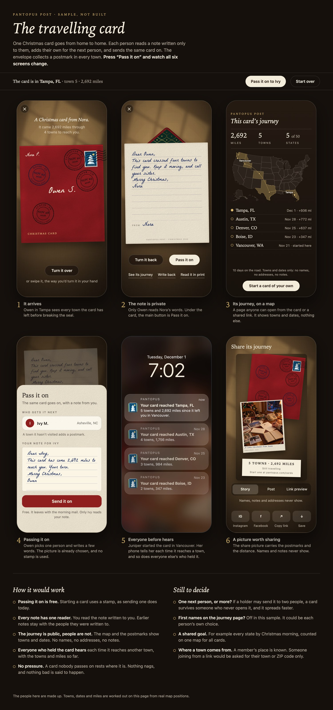
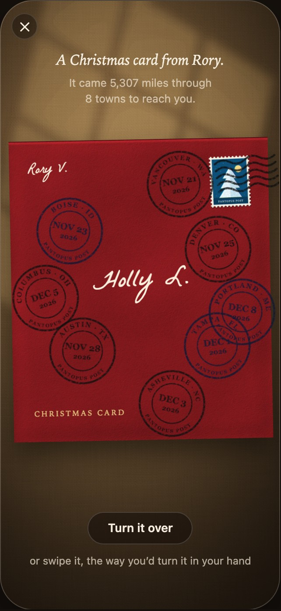

# The travelling card

November 21, 2026. A plan and a design. No app code has been changed.

The founder asked on November 21 whether sending a card is the best format, or whether another one could spread by itself. After a run of the web app (send, receive, a card link opened signed out) the answer was: the card is the right object, but each card stops at one person and its sender never sees what became of it. The founder approved a sample of the travelling card the same morning and said: "Yes, plan the build."

**The idea.** Whoever receives a Christmas card can pass the same card on, with a note of their own, to someone else. The envelope collects a postmark in every town. A public page shows the card's journey on a map: towns and dates, never names, addresses or notes. Everyone who held the card hears when it reaches another town.



The sample is the source of truth for looks: `sample/page.html` (built into one page by `sample/gen.cjs`, which adds the US outline from the `us-atlas` package; the art it shows is the app's own, in `frontend/apps/web/public/holiday-cards/`). Press "Pass it on" in the sample and every screen changes. The founder's copy is a private page; this folder's pictures show the same screens.

## What it rides on

Nothing here is a second system. Each piece extends one that is built and on staging.

| Need | What exists |
|---|---|
| A card from one person to the next | `POST /api/mailbox/cards` and `storeCard` in `backend/routes/mailbox.js`: to a member, to an email address, or by link, with the 7 a.m. delivery, take-back, blocks and email limits. |
| A second piece joined to a card | Write back (launch key `card_replies`): `/cards/:id/reply`, a row id made from the card's id (`holidayCards.replyRowId`), a sheet over the card on all three apps. Pass it on is built the same way. |
| A card that costs nothing | The database takes a stamp only from a card marked `postage_v1` (`mail_stamp_card_accounting`). A passed-on card is stored without the mark. No stamp migration. |
| The envelope's postmark | Web `CardTable.tsx` (`pmBox`), iPhone `CardTableEnvelopeFront.swift`, Android `CardTableFaces.kt`. Today one postmark with the mailed day. |
| A public card page | `/cards` and `/cards/[slug]` on the web, the card link page (`CardLinkScene.tsx`), link preview pictures under `app/api/og/`. |
| Share pictures | `CardShareSheet` on all three apps: Story, Post, Link preview. |
| Telling a sender | `notificationService.createNotification` with a link to `/app/mailbox/sent/<id>`, which both phone apps already open. |
| A person's town | `Home.city` and `Home.state` for someone with a home; `User.city`, `User.state`, `User.zipcode` otherwise. |
| Old app versions | Both phone apps ignore fields they don't know, so a travelling card opens as an ordinary card in a store build made before this. |

## Decided by the founder

On November 21 the founder was shown these six decisions with their defaults and asked whether to start the build sessions with them. The answer: "Yes, start them". The six are final.

| | Decision | Decided |
|---|---|---|
| D1 | How many people one person may pass a card to | **Two.** With one, a card dies at the first person who does nothing. With two the journey is a tree, and the map shows its branches. |
| D2 | First names on the journey page | **No.** Towns and dates only. |
| D3 | A shared goal | **Yes.** One line on every journey page and on `/cards`: "All cards this Christmas: 31 of 50 states." |
| D4 | The town of someone with no home on Pantopus | **Ask once**, "Your town or ZIP code", when they first start or pass on a travelling card. It is kept in their profile's town fields. |
| D5 | Whether a card may travel | **A switch where the card is sealed, on to begin with**: "Let it travel". Off: the card is an ordinary card and nothing about it is public. |
| D6 | The journey page inside the phone apps | **The web page, opened inside the app.** No native map in this build. |

## The rules

**Starting.** A card starts travelling when its sender leaves "Let it travel" on. It uses a stamp exactly as it does today. Each card of a list starts a journey of its own.

**Passing on.**
- Only the person who received the card can pass it on, once it is open (a card sealed until Christmas can travel from Christmas morning).
- To a person on Pantopus, to an email address, or by link: the same three ways as "Who it's for".
- Free: no stamp, and it does not count as the day's card where stamps are off.
- Up to two people (D1). A card taken back before pickup frees its place.
- Not to someone the card has already been to on its way to you.
- A note and a signature. No photo, no voice greeting.
- To a member it arrives with their 7 a.m. mail. An email goes at once. A link works at once.
- The limits that protect people stay: blocks, one card from you to the same person for one morning, and for email addresses three new ones a week and the same address once in 30 days.
- Passing on ends when cards do, on December 31.

**Privacy.**
- A note is read only by the person it was written to. Nobody later on the journey sees an earlier note or who wrote it.
- The envelope a person receives shows who sent it to them, as today, and the towns on the way to them.
- The journey page, the share pictures and the link preview show towns and dates. No names, no addresses, no notes, no ids of people or mail.
- A town's map point is the town's own centre. A person's own point is never stored on the card or sent to any app.
- The journey's id is random and long. It is in the page's address and nowhere else public.
- Add the journey page to `docs/location-privacy-matrix.md`.

**Towns.** A stop is a town and a state ("Boise, ID"). For someone with a home it is the home's town. Otherwise it is the town they gave (D4). Someone outside the United States can hold and pass on a card; their stop says "Abroad", has no map point and adds no miles.

**Postmarks.** Every pass-on strikes one postmark: the town it left and that day's date where the sender lives. The first is the town the card started in.

**Miles.** Straight-line miles between the town centres of each two stops that follow each other. A journey's miles are the sum over all its branches. Towns and states are counted once each.

**Reaching a town.** A card has reached a town when it is in that person's mailbox: at its 7 a.m. delivery for a member, or when someone joins and takes it from an email or link. A card that was taken back, or that nobody took, reached nowhere.

**Telling people.** When a card reaches a town, everyone it passed through on the way there is told, the starter included. At most one notice a day for one journey for one person; a second town the same day is counted in the next day's notice. Never before the take-back time has passed.

**No pressure.** A card nobody passes on rests. No reminder to pass it on, no countdown, no words about luck.

## Part 1. The server

New launch key `card_travel` (number 18), server only like `card_replies`; it needs `mailbox`, `holiday_cards` and `card_table`. Off: no route answers, no card says it travels, and a send that asks for it stores an ordinary card.

**What a card keeps.** In `Mail.mail_extracted.card.travel`, written by the server only:

```
travel: {
  journey:  "<random uuid>",        // the same on every card of one journey
  hop:      1,                      // 1 = the card that started it
  parent:   "<mail id>" | null,     // the card this sender received
  from:     { town, state, lat, lon, on },   // the sender's town and local date when sent: its postmark
  to:       { town, state, lat, lon, on } | null   // the receiver's town, set when the card reaches them
}
```

`lat` and `lon` are the town's centre. No new table. One additive migration adds an index so a journey's cards are found without a scan:

```sql
CREATE INDEX CONCURRENTLY IF NOT EXISTS mail_card_travel_journey_idx
  ON "Mail" ((mail_extracted->'card'->'travel'->>'journey'))
  WHERE mail_extracted->'card'->'travel' IS NOT NULL;
```

**One place per pass-on.** A passed-on card's row id is made from the card it answers and its place (1 or 2), the way a reply's is: `uuidOf(['holiday_card_travel_v1', parentId, place])`. The database then refuses a third, and two sends at once can't both take a place. Taking it back frees the place. A reply's take-back removes its row (`/cards/:id/reply/take-back`); a card to an email address or by link keeps its row, marked withdrawn, so the id also carries how many cards of that place were taken back before it.

**Towns.** Bundle the US Census Gazetteer lists of places and ZIP code areas (public domain; name, state, centre) with the backend and read towns from them. No call to an outside service, so no cost and no stored results from one. `travelTown(userId)` answers a person's town: their home's `city` and `state`, else their profile's, matched to the list for its centre.

**Routes** (all under `/api/mailbox`, all need the key):

| Route | Does |
|---|---|
| `POST /cards` and `/cards/batch` | Take `travel: true`. The server makes the journey id and `from`. Refused with `CARD_TRAVEL_NEEDS_TOWN` when the sender has no town yet. |
| `GET /cards` | Adds `travel: { on: true, town: "Boise, ID" \| null, places: 2 }` so the apps show the switch and know whether to ask for a town. |
| `GET /cards/towns?q=` | Up to 8 towns for a few typed letters or a ZIP code. |
| `PUT /cards/town` | Keeps the chosen town in `User.city`, `state`, `zipcode` (the existing profile fields). |
| `POST /cards/:id/pass-on/preview`, `POST /cards/:id/pass-on` | The card must be the caller's, open, travelling, with a place left. Body: `to` (as a send), `message`, `signature`, `request_id`, `place`. Stores a card through `storeCard` with no postage mark, the same picture, `hop + 1`, `parent`, the journey's id. |
| `POST /cards/:id/pass-on/take-back` | As a card's take-back. |
| `GET /cards/journeys/:journey` | Public, no sign-in, rate limited as the public card routes are. Answers the picture (id, caption, slug, cloth colour), the stops as `{ town, state, lat, lon, on, from }` (`from` is the index of the stop it came from), miles, towns, states, days, and the goal line (D3). Nothing else. |
| `GET /cards/journeys` | Public: states reached by all cards, cards travelling, total miles. Kept for five minutes. |

**What the apps read on a piece.** `piece.card.travel` for the reader: the journey id, the postmarks on the way to them (`[{ town, state, on }]`, oldest first), miles and towns so far, places left, and the first names of the people they passed it to. On a sender's Sent card: the journey id, towns, miles and the newest town.

**Reaching a town.** Set `to` when the card is in the mailbox (see the rules). A member's is known at 7 a.m.; ride the job that sends the morning mail notice. An email's or link's is set when it is taken. Then send the notices.

**Passing on must not be slowed by, or slow, an ordinary send.** `storeCard` takes one more option (no postage). `settleCard` and the day's-card check skip a passed-on card. Time `POST /cards` and `GET /api/mailbox/:id` on a card that doesn't travel before and after; they must not change. Run `EXPLAIN` on the journey read with a few thousand cards in the table.

## Part 2. Letting a card travel (the sender)

On "Seal it for the day", under the arrival choices, one row on the same paper:

> **Let it travel** (switch, on)
> Maya can pass this card on. Its towns show on a map, never names.

For someone with no town yet, turning it on (or leaving it on and pressing "Seal and send") opens one small sheet: "Where does it start?" with a field, "Your town or ZIP code", a list of matches, and "Use Vancouver, WA". It is asked once.

After sending, "On its way to Maya" gains one line: "It can travel. You'll hear when it reaches a town."

## Part 3. The envelope

The address side carries the postmarks of the towns on the way to this person, the first town cancelling the stamp as today's postmark does. Measures, as shares of the envelope's width (`sample/page.html`, `SLOTS` and `postmark()`):

- Ring 27% wide. Two circles; the town and state in capitals round the top ("BOISE · ID"), "PANTOPUS POST" round the bottom, the day ("NOV 23") and the year in the middle. The first postmark keeps today's five wavy lines to its right.
- Where each ring's centre goes, in % of the envelope, and its turn: (66, 15, −8°), (23, 30, 11°), (80, 37, −14°), (27, 70, 6°), (79, 69, −5°), (61, 88, 13°), (13, 52, −18°), (89, 58, 9°), (46, 28, −3°).
- Ink: today's postmark ink. Every third one, starting with the second, in blue-black `rgb(14, 22, 52)` at 84%.
- A long town name is set smaller to fit the top of the ring, down to two thirds of its size; if it still doesn't fit, the state is left off.
- More than nine: the newest nine, and "+ 4 more towns" in the gold of "CHRISTMAS CARD", bottom right.
- When the envelope arrives, the newest postmark is struck last, with the thump today's postmark has.

Above the envelope, under "A Christmas card from Nora.": "It came 2,692 miles through 4 towns to reach you." A card on its first stop says nothing more than today.



## Part 4. Pass it on

With the card turned over, "Pass it on" is the filled button beside "Turn it back". "See its journey" joins the quiet row with "Write back" and "Read it in print"; the row keeps the rule of November 17 (one row, never stacked, the rest under ⋯).

The sheet is the reply's sheet with two fields more:

- Title "Pass it on". Under it: "The same card goes on, with a note from you."
- "Who gets it next": the picker of "Who it's for" (search, an email address, a link).
- "Your note for Ivy": the pen and the saved signature, as a reply.
- One line: "Your town, Tampa, FL, goes on its journey. Never your name or address." Someone with no town is asked here (the sheet of Part 2).
- Button "Send it on". Under it: "Free. It leaves with the morning mail. Only Ivy reads your note." By email: "Free. We email Ivy now." By link: "Free. Share the link yourself."
- Sent: the sealing moment as it is for a card, then "On its way to Ivy."

After one pass-on the button reads "Pass it on to one more" and is quiet, not filled. After two it is gone, and the quiet row says "You passed it on to Ivy and Cass."

## Part 5. The journey page

`/cards/journey/<journey id>` on the web, public, in the look of the card link page.

- "PANTOPUS POST", then "This card's journey".
- Three figures: miles, towns, states "5 of 50".
- The map: the states' outlines (make one small file of outlines with `sample/gen.cjs`; no map service and no token), states reached filled in gold, a dotted line from each stop to the next, a dot at every town and a ring round each town holding the card now. The first town and the newest are named.
- The stops, newest first: "Tampa, FL", its date, "+936 mi"; the first says "started here".
- "10 days on the road. Towns and dates only: no names, no addresses, no notes."
- The goal line (D3).
- Button "Start a card of your own", to `/cards`.
- The card's picture, small, at the top right on a wide screen.

Its link preview picture (1200×630) is the map with the three figures.

## Part 6. Hearing about it

- Notice, type `holiday_card_travelled`: title "Your card reached Tampa, FL", body "5 towns and 2,692 miles since it left you in Vancouver." Several towns in a day: "Your card reached 3 more towns", body "8 towns and 4,226 miles so far." It opens that person's own Sent card (`/app/mailbox/sent/<id>`), which every app version opens.
- On a Sent card that travels: "5 towns · 2,692 miles. Now in Tampa, FL." and "See its journey".
- On the Mailbox's mantel nothing changes.

## Part 7. Sharing

- "Share this card" on a travelling card shows the envelope with its postmarks and no names behind the picture, and a slip: "5 TOWNS · 2,692 MILES", "Still travelling", "Start one at pantopus.com/cards". Story, Post and Link preview as today. The video choice stays as it is.
- Copy link on a travelling card copies the journey page's address.
- The card link page, for someone opening a link or an email: under "A Christmas card for you" and who it is from, "It came 2,692 miles through 4 towns to reach you.", and the envelope's postmarks behind the card. The email keeps saying only who it is from.

## Part 8. The shared goal (D3)

"All cards this Christmas: 31 of 50 states." on every journey page, and on `/cards` with a small copy of the map. No list of cards, no ranking.

## Part 9. iPhone, the Duo and Android

Each mirrors the web, with the server's shapes as the contract.

- The switch and the town sheet in the send flow (Part 2).
- The postmarks on the envelope (Part 3), drawn by the code that draws today's postmark.
- "Pass it on" and its sheet (Part 4), built from the reply's sheet.
- "See its journey" opens the web page inside the app (D6).
- The Sent line and the notice (Part 6).
- The share pictures with postmarks and the slip (Part 7).

On the Duo, open, the envelope and the card keep their places; nothing new crosses the hinge.

A store build made before this shows a travelling card as an ordinary card: it opens, and it can be answered, but it can't be passed on from that build. The web can.

## Checks

In the real apps, on a local backend and database, with made-up people:

- A card started on the web, passed on from the iPhone, then from Android, then by link to someone signed out who joins and gives a town. Each envelope shows the right postmarks; the journey page shows four towns, the right miles and the right states.
- Each note is readable only by its own reader: read every earlier holder's view and the public page for any trace of another note or a name.
- Two pass-ons from one card, then a third refused. One taken back before pickup, and its place free again.
- Stamps before and after a pass-on: unchanged. A start: one stamp.
- A blocked person, a business account, a card already been to that person, a sealed card before Christmas: each refused in plain words.
- A notice to the starter after the 7 a.m. delivery, one a day, and it opens Sent on both phones.
- The key off: every screen as it is today.
- The times and `EXPLAIN` of Part 1.

## Building it

Three build sessions on Opus 5.5 at Extra High, as for the card experience: server and web (with the test rig, and the key switched on in staging), iPhone with the Duo, Android. Each opens small PRs into `dev`; the design session reviews each before it merges.

Order:

1. Server, Part 1, with the shapes above fixed first so the phones can start.
2. Web, Parts 2 to 8.
3. iPhone and Android, Part 9, alongside the web.

The founder's own steps: try it on staging, promote `dev` to production, switch `card_travel` on in production, and the store builds.

## Not in this build

- Letting someone who opens a card link break the seal before giving an email address.
- The sender's own photo as the front of the card.
- Recording the opening and sending it back.
- A photo or voice greeting on a passed-on card, and "Help me write it" on its note.
- A native map on the phones.
- First names on the journey page (D2).
